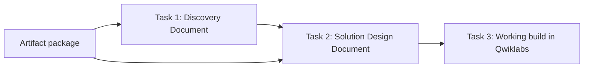

# AeroGlobal FlightOps Agent — Engagement Context (v2.1)

> **This is the governing context file.** It supersedes `AEROGLOBAL_FLIGHTOPS_CONTEXT.md` (v1, kept for history). Working rules for every document are in `ELEVATE_CONTEXT_CONSTITUTION.md`.

## 1. What this engagement is
| Item | Detail |
|---|---|
| Engagement | End-to-End Solutioning: AeroGlobal FlightOps Agent |
| Customer | AeroGlobal Airways |
| Ask | An Autonomous Flight Operations & Regulatory Disruption Resolution Agent on Google Cloud |
| My role | Customer Engineer on a new engagement |
| Window | Oct 5 – Dec 27, 2026 · Cohort W2-JAPAC-G1 |

Customer inputs: `airline_discovery_package.zip`, unzipped to `discovery_package/`. It holds call transcripts, incident logs, a whiteboard photo and a sizing sheet. Every file matters.

## 2. The three deliverables

| Stage | Output | Where | Graded by |
|---|---|---|---|
| Task 1 | Discovery Document (.md) | RAISE portal | AI evaluator; feedback on attempt 1 only; 2 attempts |
| Task 2 | Solution Design Document (.md) | RAISE portal | AI evaluator against Google Cloud Well-Architected Framework + SAIF; feedback on attempt 1 only; 2 attempts |
| Task 3 | Working agent | Qwiklabs lab, via its command line | Automated lab checks (pass ≥ 20 of 25) |

Both documents follow the **official templates strictly** (same sections, same order, same table columns; no added or removed sections). They are Markdown only (max 50 MB) and every diagram is Mermaid.

## 3. Task 1 — Discovery Document
Turn the artifacts into a document capturing what the customer needs, what constraints they impose, and what is still unresolved. It is the input to Task 2, so gaps carry forward.

Evaluated on:
- Complete requirements across all artifacts
- Verifiable evidence and traceability for each requirement
- Clear, testable, well-classified requirements
- Prioritization with rigorous justification
- Risks, conflicts and ambiguities detected
- Integrity, clarity and scope discipline
- Concise, decisive trade-off recommendations

Template: `Discovery Document Template.pdf` (Document Control + sections 1–15).

**Lesson from the attempt-1 scorecard:** the RAISE evaluator scored the Discovery Document on the 7 Solution Design dimensions (autonomy, topology, SAIF, reliability, observability, latency/tokens, ADRs). The final Discovery Document therefore carries a labelled engineering layer inside the template: engineered NFRs and acceptance criteria, plus a "Preliminary solution hypothesis" in §15.2. Tracked in `deliverables/change_checklist_discovery.md`.

## 4. Task 2 — Solution Design Document
Design an end-to-end agentic solution on Google Cloud that answers the Task 1 requirements (re-read the original artifacts too). Cover functional requirements, agent orchestration, data flow, security/governance and integration patterns.

Evaluated on:
- Autonomy boundaries and measurable success criteria
- Agent topology, compute, memory and tools
- SAIF-aligned security, privacy and compliance
- Reliability, resiliency and state integrity
- Observability, auditability and evaluation pipelines
- Latency and token economics
- Architectural decision records and justified trade-offs

Template: `Solution Design Document Template.pdf` (Document Control + 8 sections: 1 Executive Summary & Problem Framing · 2 System Architecture & Topology · 3 Security, Privacy & SAIF Alignment · 4 Resiliency, Reliability & State Integrity · 5 Observability & AgentOps · 6 Performance Optimization & FinOps · 7 ADRs · 8 FMEA).

### How the SDD also drives the build (within the strict template)
- **Production design throughout.** Each component in the SDD is tagged inline **[MVP]** (built first; what the lab reproduces) or **[Production hardening]** (e.g., org-level controls, CMEK, multi-region failover that a temporary lab project may not support). These tags are content, not new sections, so the template stays intact.
- **Lab runbook is a separate working file**, not part of the submission: `lab_kit/03_Lab_Runbook.md`. It uses the same component names as the SDD, written as numbered phases. Each phase has:

| Field | Content |
|---|---|
| Goal | What this phase delivers |
| Commands | Copy-pasteable CLI commands using variables (`$PROJECT_ID`, `$REGION`, etc.) |
| Verify | A command that proves it worked |
| Expected result | What success looks like |
| If it fails | Likely cause and next action |

Typical phase order: environment and variables → enable APIs → IAM / service identities → data and tool setup → agent code → local test → deploy → register / publish → guardrails → evaluation → final check against the lab's graded items → gateway teardown last.

## 5. Task 3 — Build in Qwiklabs
- The build happens in the Qwiklabs (Labs for Sales) environment, using its command line. Brief: `task3.md`. Tasks 1–2 are independent of Task 3, and nothing is uploaded.
- The lab provides its own instructions and automated checks. Where they differ from the SDD (names, region, model, file paths), the lab's version is used and the runbook is adjusted.
- Working method: read all lab tasks first → map each graded check to a runbook phase → run one phase at a time → share the command output and lab progress → confirm, then move to the next phase.
- Progress is tracked in `lab_kit/RUNLOG.md` (phase, commands run, result) so the build can resume quickly after any interruption.
- The lab is ended only after the passing score shows.

## 6. Inputs in this folder
| Input | Path | Status |
|---|---|---|
| Customer artifact package (11 files) | `discovery_package/` | **Verified original**: all 11 files byte-identical to `airline_discovery_package_6c83af4.zip` (2026-10-14) |
| Duplicate copy of the package | ` Task 1_Discovery /` | Identical to `discovery_package/` (no `context1.md`); not a separate source |
| Task 1 portal brief | `discovery_package/context1.md` | Portal copy, **not** a customer artifact. Exclude from the artifact review log |
| Task 2 portal brief | `Task2_Solution Design/context_solution_Design.md` | Portal copy |
| Task 3 portal brief | `task3.md` | Portal copy |
| Discovery Document Template | `Discovery Document Template.pdf` | Official |
| Solution Design Document Template | `Solution Design Document Template.pdf` | Official |
| Whiteboard (A04) transcription | `Travelers & Staff (App · Kiosk · NOC · Contact Center)` → `Access & Trust Controls` → `Flight Ops Agent (understand · reason · decide)` → {`Compensation & Refunds`, `Rebooking & Hotel Vouchers`, `Crew Duty Alerts`, `Human Review`}; below the agent: `Operational Data (flights · bookings · crew · baggage)`, `Policy & Regulatory Library`; spanning the bottom: `Audit & Monitoring` | Transcribed from the image |

## 7. Working layout
| Path | Content |
|---|---|
| `deliverables/archive/01_Discovery_Document_v2.md` | Task 1 attempt 1 as submitted (frozen) |
| `deliverables/01_Discovery_Document_v3.md` | **Final Discovery** (feedback and review fixes applied); Part 1 of the consolidated upload |
| `deliverables/archive/02_Solution_Design_Document_v1.md` | SDD v1 (frozen) |
| `deliverables/archive/02_Solution_Design_Document_v2.md` | SDD v2 (superseded) |
| `deliverables/02_Solution_Design_Document_v3.md` | **Final SDD** (review fixes applied); Part 2 of the consolidated upload; blueprint for the Task 3 lab runbook |
| `lab_kit/03_Lab_Runbook.md` | Task 3 working runbook (not submitted); pulled into the lab via git |
| `lab_kit/RUNLOG.md` | Task 3 execution log (created at lab start) |
| `deliverables/feedback/` | Scorecards and reviews (git-ignored; `archive/` holds older reviews) |

## 8. Google Cloud building blocks used in the course labs
These are the components the course labs built and deployed with. A design built on them is easiest to reproduce in Qwiklabs.

| Need | Component |
|---|---|
| Agent framework | Agent Development Kit (ADK): LlmAgent, SequentialAgent / ParallelAgent / LoopAgent, tools, callbacks, session state |
| Scaffold & deploy | `agents-cli` (scaffold, run, deploy, eval, publish gemini-enterprise) |
| Runtime | Agent Runtime (managed sessions + memory; auto-registers in Agent Registry). Cloud Run as alternative (scale-to-zero; manual registry entry) |
| Sessions / memory | VertexAiSessionService or DatabaseSessionService; Memory Bank for long-term memory |
| Discovery & governance | Agent Registry; Agent Identity (agent's own identity + delegated user OAuth via Auth Manager); Agent Gateway |
| Safety | Model Armor (prompt injection/jailbreak, sensitive data, malicious URLs, RAI filters); ADK before_model / before_tool callbacks |
| Data access | MCP Toolbox for Databases (BigQuery, AlloyDB, Cloud SQL, Spanner); Cloud Storage; BigQuery |
| User front end | Gemini Enterprise app (agent published to it) |
| Evaluation | adk eval / agents-cli eval (trajectory + response); Vertex AI EvalTask |
| Observability | OpenTelemetry → Cloud Trace and Cloud Logging |
| Cost levers | Model routing (Flash-Lite / Flash / Pro), context caching, batch for async work |

## 9. Program guidance (official FAQ / Playbook first; peer notes second)
| # | Guidance | Source |
|---|---|---|
| G1 | **Only the first lab attempt counts.** Complete all tasks before clicking End Lab | Official FAQ (go/elevate-capstone-faq) Q5 |
| G2 | Lab: ~6-hour timer, 25 automated checks, pass at 20 | Peer notes; confirm in the lab |
| G3 | **Run the gateway-teardown check last**, only after checks 1–24 have scored | Peer notes |
| G4 | `agy` (Antigravity) in the lab VM can automate the build. Wait 2–4 min after start; sign in with "Business Account" / "Project ID" using the `student-…` credentials; if it closes after ~2 s run `sudo pkill -9 antigravity` | Peer notes |
| G5 | If stuck, don't leave the lab; ask in #elevate-capstone-support | Playbook; peer debrief |
| G6 | RAISE: upload `.md` (not PDF); keep table cells ≤ 25 words; set a sharp **read-only MVP cut line** for Phase 1; include JSON Schema / Pydantic tool contracts and GCP billing labels in the SDD | Peer notes |
| G7 | Do Task 1 and Task 2 in one continuous context | Peer debrief |
| G8 | **Confidentiality:** never share scenario briefs, lab specifics or solution code. The GitHub repo stays private | Playbook / FAQ (via peer notes) |

## 10. Status tracker
| Item | Status | Notes |
|---|---|---|
| Grounding package verified | done | 11/11 files match the original zip |
| Task 1 Attempt 1 | submitted 2026-10-15 | `01_Discovery_Document_v2.md` uploaded to the Discovery portal |
| Task 1 feedback | received | `deliverables/feedback/official_feedback_discovery_2.md` |
| Task 1 Final | submitted 2026-10-15 (final) | `deliverables/01_Discovery_Solution_Design_Consolidated_v3.md` (Discovery v3 + SDD v3) |
| Task 2 Attempt 1 | used by mistake | Discovery v1 uploaded to the SDD portal (scorecard = official_feedback.md) |
| Task 2 feedback | received | `deliverables/feedback/official_feedback.md` |
| Task 2 Final | used by mistake; support: 'processed, move forward' | Discovery v2 uploaded to the SDD portal; real SDD ready: `deliverables/02_Solution_Design_Document_v1.md` |
| Build lab | not started | `lab_kit/03_Lab_Runbook.md`, `lab_kit/RUNLOG.md` |
