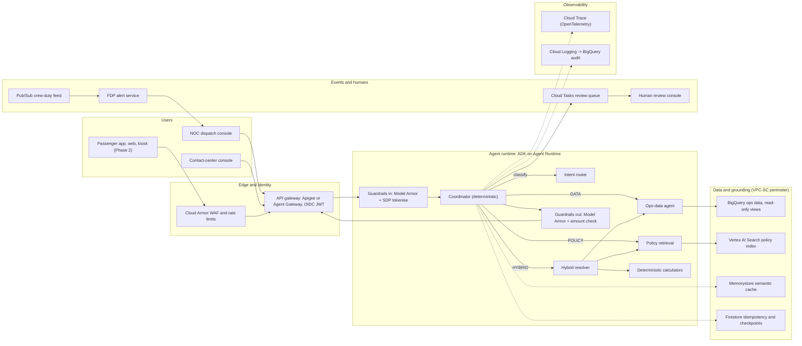
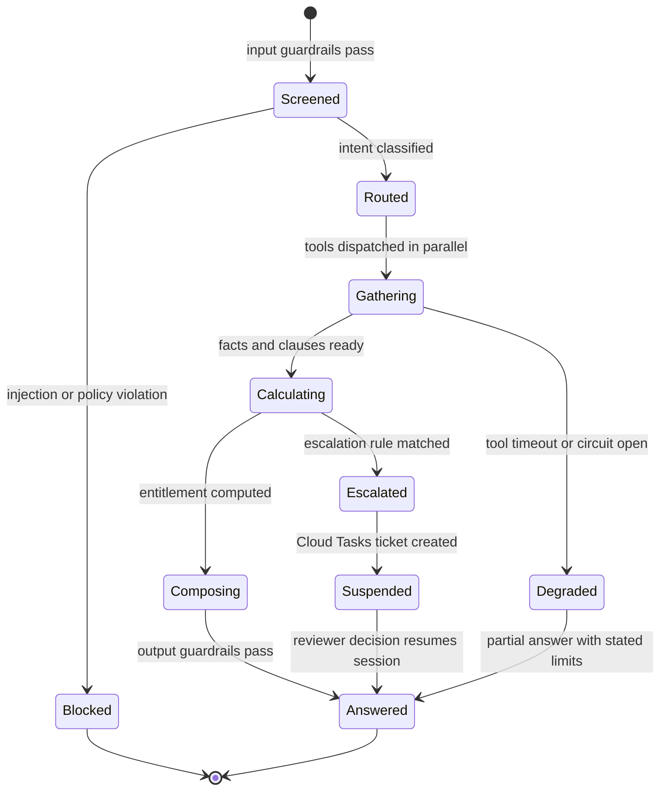
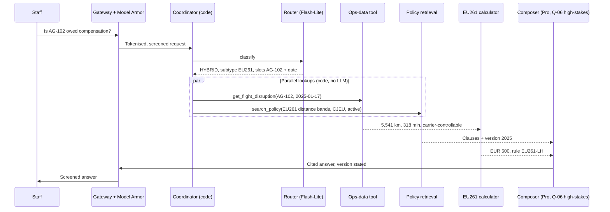
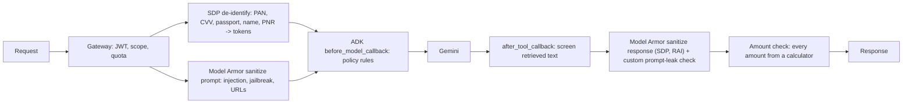
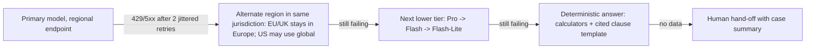
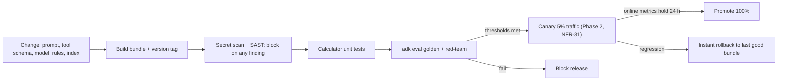

# Enterprise Agent Solution Design Document

**AeroGlobal Airways - Autonomous Flight Operations & Regulatory Disruption Resolution Agent ("FlightOps Agent")**

## Document Control

| Field | Value |
|---|---|
| Author | Amandeep Singh, Customer Engineer |
| Date | 2026-10-15 |
| Version | 3.0: aligned to Discovery v3 (Phase 1a MVP / 1b fast-follow; options resolved in ADRs); review fixes applied |

Inputs: the Discovery Document (requirements FR-/NFR-/CON-/DATA-, tensions TEN-, conflicts CFL-, questions Q-, assumptions ASM-) and the original AeroGlobal artifact package (A00-A06, incidents INC-882914/883042/883199/883250). Phases follow the Discovery backlog: **1a** = MVP live before the first winter storm, **1b** = fast-follow during the first winter, then Phase 2 and Phase 3. Every component is tagged **[MVP]** (buildable in a single project) or **[Production hardening]** (org-level controls, multi-region or customer-system integration), with the phase in which it must be live. Values marked *proposed* are design starting points tuned in Phase 1 load tests.

## 1. Executive Summary & Problem Framing

### 1.1 Business Context & Problem Statement

**Problem.** AeroGlobal lost $52.4M to irregular operations (IROPS) in 2024: $18.6M statutory penalties and payouts, $12.1M off-contract lodging, $14.2M FAA Part 117 crew cascades and $7.5M high-yield churn [A00 Sec. 1.2]. Winter Storm Orion alone cost $14M in four days [A01 @00:01:14]. Staff cannot combine siloed flight data (SABRE PSS, CRM, baggage mainframe) with 100+ page policy manuals under storm pressure [A00 Sec. 1.4]. Four live incidents show the failure modes: an APU fault misclassified as weather (240 unlawful EU261 denials, UK CAA sanction warning), a crew timeout on the taxiway (3 rotations cancelled), a PAN/passport leak into Slack (Sev-1 PCI/GDPR), and a Montreal-vs-domestic baggage cap error.

**Target users.**

| User | Phase | Need |
|---|---|---|
| NOC dispatchers | 1a | Crew-duty alerts, delay causality, cited policy, in seconds |
| Contact-center agents | 1a; caps, waivers, escalation 1b | Statutory entitlements, lodging caps, waivers, escalation |
| Legal / compliance | 1a | Reproducible, tamper-evident decision trail |
| Passengers (app, web, kiosk) | 2 | Self-service disruption help (after CISO public-launch gate) |

**Solution in one line.** A multi-agent system on Google Cloud (Agent Development Kit on Agent Runtime) that routes each request to data, policy or hybrid reasoning, computes every entitlement with **deterministic, tested calculators** (never the LLM), grounds policy answers in the **active** manual version, and runs behind a Zero-Trust gateway with Model Armor and Sensitive Data Protection guardrails.

**Expected outcome (Phase 1a MVP, internal, read-only advisory at ORD, DFW, LHR before the first winter storm; Phase 1b during the winter).** 100% correct statutory decisions on the incident golden set, Part 117 alerts 30 minutes before expiry, zero PII exposure, and a measured cost baseline; the < $0.15 per resolution target (vs $18.50 per human call [A04b]) applies at Phase 2 volume.

### 1.2 Autonomy Boundaries & Scope Definition

| Capability | Autonomy | Phase | Boundary and control | Reqs |
|---|---|---|---|---|
| Statutory calculation (EU261/UK261, DOT Part 260, Montreal, right to care) | **Automated** (advice) | 1a | Deterministic calculator output shown to staff; no payment executed | FR-02-07, FR-32 |
| Cited policy answers | **Automated** | 1a; citation 1b | Active version only; clause and version cited | FR-17, FR-36 |
| Part 117 crew alert, relief-crew lookup | **Automated** (alert) | 1a alert; 1b lookup | Dispatcher decides; agent never edits crew assignments | FR-08, FR-09 |
| Lodging, meal, waiver entitlements | **Automated** (advice) | 1b | Contracted caps only (ORD $140, DFW $120, LHR EUR 150) | FR-10, FR-12, FR-13 |
| Escalation routing | **Automated** routing | 1b | Rules: claim > $2,500, medical, Exec Platinum churn, high fraud score | FR-16 |
| Masking, injection blocking | **Automated** enforcement | 1a | Always on; every block audited | NFR-27, FR-24 |
| Voucher issuance | **Human-gated**, then bounded autonomy | 2 | Governed executor within caps after CISO sign-off (ADR-04) | FR-11, FR-29 |
| Rebooking, interline endorsement | **Human-gated** | 2 | Staff confirms each change | FR-15 |
| Cash payouts, high-value or disputed claims | **Human decision** | 1b+ | Agent prepares the case; named rule owner (CON-14) | FR-16 |
| Kiosk guest lookup | **Out of scope until Phase 3** | 3 | Scoped read-only token plus second factor, subject to CISO decision (Q-03) | FR-22 |
| Dispatch release, fuel planning, crew legality override | **Out of scope (never)** | - | Certified dispatch systems only | Discovery Sec. 7.1 |
| Writes to reservation/crew tables, schema changes | **Out of scope (never)** | - | Read-only agent identity | CON-02 |
| Answers from archived 2022 manual to passengers | **Out of scope (never)** | - | Legal-only historical access | FR-17, FR-18 |

**Scope by phase.** Phase 1a: 12 advisory capabilities, 11 non-negotiable controls and 5 data items (Discovery Sec. 2.4), internal staff, read-only, 3 hubs. Phase 1b: waivers, relief crew, caps, escalation, freshness pipeline, release safety. Phase 2: governed write executor, passenger channels at storm scale. Phase 3: kiosk guest path, multi-region DR, optimisations.

**Traceability: Discovery requirements to design.**

| Discovery items | Phase | Design element | Section |
|---|---|---|---|
| FR-01, FR-30 | 1a | Intent router and deterministic coordinator; staff consoles call the agent through the gateway (CON-01) | 2.1, 2.2 |
| FR-02-07, FR-32 | 1a | Deterministic calculators and evaluate_jurisdiction tool | 2.2, ADR-03 |
| FR-17 | 1a | Policy retrieval with coordinator-set active-version filter | 2.2, 2.3 |
| FR-08, NFR-02, DATA-05 | 1a | Crew feed and FDP alert service | 2.1, 2.3 |
| FR-19, DATA-01, DATA-04 | 1a | BigQuery through MCP Toolbox; parameterised read-only templates | 2.3, ADR-07 |
| DATA-02 | 1a | Vertex AI Search index; 500/100-token chunks; version metadata | 2.3, ADR-02 |
| NFR-27, NFR-22a-22b, FR-24 | 1a | Model Armor and SDP guardrails; amount-source check | 3.1 |
| NFR-23, NFR-25a | 1a | VPC-SC, PSC, deny-by-default egress; EU/UK regions | 3.3 |
| NFR-15, NFR-17a-17b | 1a | CI gates: golden set, red-team, secret scan, SAST | 5.3 |
| NFR-40, NFR-42 | 1a | Per-turn call and token ceilings; budget alerts | 4.1, 6.2 |
| FR-26, FR-28 | 1a | Tamper-evident audit sink; erasure deletes the passenger's token mapping | 5.2, 3.3 |
| FR-09-10, FR-12-13, FR-16, DATA-03 | 1b | get_relief_crew, right-to-care caps, check_waiver_eligibility, review queue | 2.2 |
| NFR-09-10, NFR-34a-34c, NFR-25b | 1b | Bounded queries; publish pipeline; no passenger data in any cache; NFR-25b covers 1b pinned clauses and Phase 2 caches | 2.3, 6.1 |
| NFR-12-13, NFR-33, NFR-41, NFR-43 | 1b | Circuit breakers, parallel reads, latency budget, timeouts, cycle detection | 4.1, 4.3, 6.1 |
| NFR-16, NFR-32, NFR-37-39, NFR-44, FR-36 | 1b | Bundle versions, rollback, eval thresholds, dashboards, clause citations | 5.1-5.3 |
| Phase 2 and 3 items | 2-3 | Write executor, passenger channels, caches, guest path, DR | 1.2, ADR-04, ADR-09 |

### 1.3 Workload-Specific Acceptance Criteria & SLAs

| Metric | Target | Phase | Measurement | Source |
|---|---|---|---|---|
| Time to first visible output (progress or token) | p95 <= 1.0 s | 1a (measured) / 3 (enforced, NFR-35) | Span gateway->first stream chunk | Proposed (ASM-14) |
| Full answer, standard query | p95 <= 2.5 s | 1a (measured) / 1b (enforced, NFR-33) | End-to-end trace duration | A04b; INC-882914 |
| Crew-duty check | < 30 s (100%) | 1a | Replay suite | A01 @00:03:06 |
| Analytics / historical query | p95 <= 30 s | 3 | Trace duration, analytics class | Proposed |
| Concurrency at storm | 10,000 sessions, 0 dropped | 2 | Load test | INC-882914 |
| Availability (Phase 1a) | 99.9% monthly (proposed) | 1a | Uptime check on gateway | Proposed (Discovery Q-19) |
| Intent routing and tool-selection precision | >= 0.90 | 1a | adk eval trajectory | INC-883042 |
| Statutory golden cases (AG-102, AG-503, AG-884) | 100% correct | 1a | Golden set in CI | INC-883042; INC-883250 |
| Grounding faithfulness | >= 0.90 | 1a (measured) / 1b (gated) | Vertex AI evaluation, pointwise | Proposed (ASM-15) |
| Context recall (governing clause retrieved) | >= 0.85 | 1a (measured) / 1b (gated) | Retrieval eval on golden set | Proposed (ASM-15) |
| Schema-valid tool parameters | >= 0.99 | 1a (measured) / 1b (gated) | Validation errors / tool calls | Proposed (ASM-15) |
| Adversarial override block rate | 100% | 1a | Red-team set | A04b |
| False refusals on legitimate angry users | 0 on test set | 1a | GC-08 family | A02 @00:06:46 |
| Raw PII/PAN in context, logs, caches | 0 | 1a | DLP scans of sinks | INC-883199 |
| Unit cost per resolution, all-in | < $0.15 | 1a (measured) / 2 (at scale) | Billing export / resolutions | A04b |
| Input-token saving vs naive | >= 75% | 1a (measured) / 2 (at scale) | Token telemetry | INC-883042 |
| Query scan reduction | >= 85% | 1b | BigQuery bytes billed | INC-882914 |
| Policy freshness | Event-driven; <= 3,600 s max | 1b (1a: re-index on each publish) | Publish-to-answer delay | A04b; A02 @00:08:12 |
| DR | RTO < 60 s, RPO = 0 | 3 | Failover drill | A04b (unvalidated) |
| Pro explanation (high-stakes, after entitlement line) | p95 <= 6 s | 1b | Trace duration, Pro class | Proposed; new class beyond ASM-14 (TEN-05) |
| Successful-turn SLI and error budget | 99.9% good turns per 28 days; exhaustion freezes non-fix releases | 1a (measured) / 1b (enforced) | Gateway and trace logs; burn-rate alerts | Proposed (Discovery Q-19) |
| Storm-surge load test | Phase 1 targets held at 3x peak internal concurrency, with tool fault injection | 1a (measured) / 1b (gate) | Load test in staging | Proposed (DA-05) |
| Tokens per resolution (efficiency and carbon proxy) | <= 6,350 | 1a (measured) | Token telemetry | Proposed (DA-02) |

**Design assumptions (planning values; moved from the Discovery assumptions register).**

| ID | Assumption | Validation |
|---|---|---|
| DA-01 | Idempotency keys kept 24 h; semantic cache TTL 15 min keyed by policy version. | Phase 2 retry tests |
| DA-02 | A resolution uses up to 3 model calls (route, plan, compose) and ~6,000 uncached input tokens. | Measured in the Phase 1a pilot |
| DA-03 | AeroGlobal accepts the Google Cloud stack in Sec. 2 (ADK, Agent Runtime, Model Armor, BigQuery, Vertex AI Search). | Confirmed through the ADRs (Sec. 7) |
| DA-04 | Latency stage split (Sec. 6.1), 5-minute alert latency and 10% success-trace sampling are planning values. | Per-stage spans in Phase 1a |
| DA-05 | Starting values: 1 warm instance per region; semantic cache 1 GB LRU; HNSW m=16, ef_construction=64 if ADR-02 option (b) is used. | Phase 1 load tests |
| DA-06 | Cached tokens bill at fraction d of input price (0.10-0.25 tested); costs use the naive blended rate. | Confirm pricing with FinOps |

## 2. System Architecture & Topology

### 2.1 Architecture Diagram



| Component | Google Cloud service | Purpose | Tag | Live by (phase) |
|---|---|---|---|---|
| Gateway | Apigee or Agent Gateway | OIDC JWT, scope airline.operations.agent, quotas | [MVP] (Agent Gateway) / [Production hardening] (Apigee) | 1a |
| Edge protection | Cloud Armor | WAF, bot and rate limiting for passenger channels | [Production hardening] | Phase 2 |
| Agents | ADK agents on Agent Runtime | Orchestration, sessions, registry | [MVP] | 1a |
| Agent discovery | Agent Registry | Versioned agent and tool catalogue | [MVP] | 1a |
| Guardrails | Model Armor, Sensitive Data Protection | Injection, jailbreak, PII/PCI | [MVP] | 1a |
| Ops data | BigQuery + MCP Toolbox for Databases | Read-only, parameterised queries | [MVP] | 1a |
| Policy index | Vertex AI Search (metadata filters) | Version-aware grounding | [MVP] | 1a |
| Semantic cache | Memorystore for Redis | Repeat-question reuse | [Production hardening] | Phase 3 (NFR-08) |
| Idempotency, checkpoints | Firestore | Keys with TTL, step checkpoints | [MVP] | 1b (checkpoints, review dedupe); Phase 2 (writes) |
| Crew feed, alerts | Pub/Sub + Cloud Run alert service | Event-driven Part 117 alerts | [Production hardening] (crew system) | 1a |
| Review queue | Cloud Tasks | Human-in-the-loop hand-off | [MVP] | 1b (FR-16) |
| Staff front end | NOC and contact-center consoles; Gemini Enterprise app optional | Consoles call the agent through the enterprise gateway (CON-01); Gemini Enterprise only if routed via Agent Gateway | [MVP] | 1a |
| Observability | Cloud Trace, Cloud Logging, BigQuery | Traces, audit, analytics | [MVP] | 1a (trace, audit); 1b (dashboards) |
| Perimeter, keys | VPC-SC, PSC, Cloud KMS (CMEK) | Exfiltration and key control | [Production hardening] | 1a (real PII at LHR) |

### 2.2 Agent Topology & Orchestration Flow

**Topology.** A deterministic coordinator (custom ADK BaseAgent, no LLM) owns control flow; LLMs are used only where judgement is needed. A hybrid turn therefore makes **2 model calls** (route, compose); open-ended data questions make **3** (route, plan, compose). The latency and cost models use the 3-call worst case.

| Agent | ADK type | Model | Tools | Writes to session state |
|---|---|---|---|---|
| `coordinator` | Custom BaseAgent (deterministic) | none | Calls tools from code; enqueue_human_review | `turn.step_count`, `turn.status` |
| `intent_router` | LlmAgent with output_schema (RouteDecision) | Flash-Lite | none | `intent`, `subtype`, `slots` (flight_id, service_date, hub, claim_token), `missing[]` |
| `planner` | LlmAgent (only if slots missing or multiple tool sets) | Flash | tool selection and argument binding | `plan[]` |
| `ops_data_agent` | LlmAgent (DATA intent only) | Flash | MCP Toolbox: get_flight_disruption, get_crew_duty, get_baggage_claim | `facts.*` |
| `policy_retrieval` | Function step (no LLM) | none | search_policy (Vertex AI Search, filter is_active=true) | `clauses[]` |
| `hybrid_resolver` | Code path in coordinator: asyncio.gather(facts, clauses) -> calculator -> composer | none until composer | get_flight_disruption, search_policy, calculators | `facts.*`, `clauses[]`, `entitlement` |
| `composer` | LlmAgent | Flash; Pro for Q-06 high-stakes intents | none (reads state only) | `answer` |
| `fdp_alert_service` | Not an LLM: Cloud Run subscriber | - | Pub/Sub crew feed | alert events |

**Routing and argument binding.** The router returns a typed `RouteDecision`: intent (DATA / POLICY / HYBRID / ESCALATE), subtype (EU261, BAGGAGE, CREW, LODGING, WAIVER, REFUND) and extracted slots. For HYBRID turns the coordinator maps subtype to a fixed tool set (e.g., EU261 -> get_flight_disruption + search_policy + evaluate_jurisdiction + compute_eu261_compensation) and binds the extracted slots; independent reads run concurrently. Only when slots are missing or the question spans several subtypes does the `planner` (Flash) select tools and bind arguments, making it a 3-call turn. Tool-selection precision (Sec. 1.3) is therefore measured on router subtype + slot accuracy and on planner output.

**Hand-off protocol.** Agents exchange typed state only (Pydantic models below); no free-text hand-offs. Each specialist returns either a result object or a structured error `{code, message, retryable, hint}`. The coordinator owns retries and fallback. The composer may only cite `clauses[]` and amounts from `entitlement`; an output check rejects any currency amount not produced by a calculator.

```python
class FlightFacts(BaseModel):
    flight_id: str; service_date: date; arrival_delay_min: int
    great_circle_km: float; is_carrier_controllable: bool; disruption_code: str

class RouteDecision(BaseModel):
    intent: Literal["DATA", "POLICY", "HYBRID", "ESCALATE"]
    subtype: Literal["EU261", "BAGGAGE", "CREW", "LODGING", "WAIVER", "REFUND", "OTHER"]
    slots: dict[str, str]; missing: list[str]

class Entitlement(BaseModel):
    regime: Literal["EU261", "UK261", "DOT260", "MONTREAL"]
    amount: Decimal; currency: Literal["EUR", "GBP", "USD", "SDR"]
    rule_id: str; rule_owner: str; rationale: str
```

**State machine per turn.**



**Hybrid flow (AG-102, golden case GC-01).**



**Human-in-the-loop flow.** `check_escalation` matches (e.g., AG-503 claim $2,850 > $2,500) -> `enqueue_human_review` creates a Cloud Tasks task (named by the idempotency key) that delivers the case to the review service, which stores it for the console -> session state `turn.status = SUSPENDED` with checkpoint -> reviewer decides in the console -> callback writes decision and reviewer ID to the audit trail and resumes the session with the decision in state.

**Tool contracts (read tools separated from mutating actions).**

| Tool | Class | Input (required) | Output | Errors | Phase |
|---|---|---|---|---|---|
| get_flight_disruption | Read | flight_id, service_date | FlightFacts | NOT_FOUND, DATE_REQUIRED | 1a |
| get_crew_duty | Read | flight_id | crew_token, fdp_end_utc, remaining_min, data_age_s | STALE_FEED | 1a |
| get_baggage_claim | Read | claim_token | delay_h, fee_paid_usd, claim_usd, special_declaration | NOT_FOUND | 1a |
| search_policy | Read | query, jurisdiction (version filter set by coordinator from JWT role, not the model) | clauses[doc, version, clause_id, text] | NO_MATCH | 1a |
| evaluate_jurisdiction | Compute | origin, destination, carrier, itinerary_type | regimes[] in precedence order, rule_id | ROUTE_UNKNOWN | 1a |
| compute_eu261_compensation | Compute | distance_km, arrival_delay_min, carrier_controllable, regime | Entitlement | REGIME_NOT_APPLICABLE | 1a |
| compute_baggage_liability | Compute | itinerary_type, claim_usd, special_declaration | cap, payable, rule_id | OUT_OF_RANGE | 1a |
| compute_right_to_care | Compute | hub, delay_min, tier, overnight | meals, hotel_cap, transfer | HUB_UNKNOWN | 1a (caps 1b) |
| compute_dot_part260_refund | Compute | itinerary_type, delay_min, cancelled, alt_declined, bag_delay_h, bag_fee_usd | fare_refund_due, bag_fee_refund, due_by, rule_id | THRESHOLD_UNCONFIRMED (15-30 h band, Discovery ASM-11) | 1a |
| check_waiver_eligibility | Compute | fare_bucket, tier, waiver_id, service_date | fee_waived, fare_diff_waived, lodging, rule_id | NO_ACTIVE_WAIVER | 1b |
| get_relief_crew | Read | hub, fdp_alert_id | relief_crews[crew_token, base, available_from_utc], data_age_s | STALE_FEED | 1b |
| check_escalation | Compute | claim_usd, tier, medical_flag, fraud_score | escalate, reasons[] | - | 1b |
| enqueue_human_review | Queue write | case_id, reasons[], trace_id | ticket_id | DUPLICATE (returns prior) | 1b |
| issue_voucher | Mutate, executor only (Phase 2) | idempotency_key, pnr_token, amount, hub | voucher_id, qr_ref | CAP_EXCEEDED, DUPLICATE | 2 |

```json
{
  "name": "compute_eu261_compensation",
  "input": {"type": "object", "additionalProperties": false,
    "required": ["distance_km", "arrival_delay_min", "carrier_controllable", "regime"],
    "properties": {"distance_km": {"type": "number", "minimum": 0},
      "arrival_delay_min": {"type": "integer", "minimum": 0},
      "carrier_controllable": {"type": "boolean"},
      "regime": {"enum": ["EU261", "UK261"]}}},
  "output": {"type": "object", "required": ["amount", "currency", "rule_id", "rule_owner"],
    "properties": {"amount": {"type": "number"}, "currency": {"enum": ["EUR", "GBP"]},
      "rule_id": {"type": "string"}, "rule_owner": {"type": "string"}, "rationale": {"type": "string"}}},
  "error": {"type": "object", "required": ["code", "retryable"],
    "properties": {"code": {"enum": ["MISSING_FIELD", "OUT_OF_RANGE", "REGIME_NOT_APPLICABLE"]},
      "message": {"type": "string"}, "retryable": {"type": "boolean"}, "hint": {"type": "string"}}}
}
```

**Self-correction loop.** On a schema or business error the router/planner (or the DATA-intent agent) receives the structured error and may retry with corrected arguments at most twice; a repeated identical call halts the turn (Sec. 4.1).

### 2.3 Compute Runtime & Model Selection

| Concern | Selection | Configuration | Tag |
|---|---|---|---|
| Agent runtime | Agent Runtime (Vertex AI Agent Engine) | Phase 1: regional; min_instances 1, max_instances 100, 4 vCPU / 8 GiB, container concurrency 10 (~1,000 concurrent; proposed) | [MVP] |
| Fallback runtime | Cloud Run, first-generation environment (gVisor sandbox) | Concurrency 20 per instance; max 500 instances (10,000 / 20); min 1 (proposed) | [Production hardening] |
| Phase 2 scale | Target 10,000 concurrent sessions (NFR-03): raise Agent Runtime max_instances (quota) or use the Cloud Run path (500 x 20); validated by load test | [Production hardening] |
| FDP alert service | Cloud Run (Pub/Sub push) | Min 1 instance at each Phase 1 hub region; concurrency 80 | [Production hardening] |
| Session state | Agent Runtime sessions (VertexAiSessionService) | Session TTL 24 h; long-term memory (Memory Bank) deferred | [MVP] |
| Ops data | BigQuery via MCP Toolbox (Cloud Run service, own SA) | Partition by scheduled_departure; cluster by flight_id, carrier_jurisdiction; authorised table-valued functions | [MVP] |
| Grounding | Vertex AI Search data store (managed hybrid semantic + keyword retrieval) | Ingestion job pre-splits manuals into 500-token chunks with 100-token overlap, tables kept whole; each chunk indexed with is_active, version, clause_id | [MVP] |

**Model-to-task mapping.** Model IDs are pinned per agent bundle to the current GA Gemini Flash-Lite, Flash and Pro versions at build; the IDs shown are illustrative. Published discontinuation dates are tracked, and replacements pass the release pipeline (Sec. 5.3) at least 60 days before retirement. Structural tiering exists from 1a; NFR-07 (Phase 3) is the target of 100% adherence to the Q-06 list.

| Cognitive task | Model | Why | Fallback |
|---|---|---|---|
| Intent routing, guard classification | Gemini Flash-Lite | Lowest latency and cost; output_schema enforced | Rules-based keyword router |
| Tool planning, summaries, standard answers | Gemini Flash | Strong tool use at low cost | Flash-Lite with stricter prompt |
| High-stakes answers (Q-06: compensation, refund, liability, dispute) | Gemini Pro | Deeper reasoning; amounts still from calculators | Flash + human review |
| Embeddings for policy index | Vertex AI text embedding model | Managed by Vertex AI Search | - |

**Deployment manifest (illustrative).**

```python
remote_agent = agent_engines.create(
    agent_engine=flightops_app,                  # ADK app, bundle fo-2026.01.2
    display_name="flightops-agent-p1",            # model IDs illustrative; pinned to current GA at build
    service_account="sa-flightops-agent@PROJECT.iam.gserviceaccount.com",
    min_instances=1, max_instances=100,
    resource_limits={"cpu": "4", "memory": "8Gi"}, container_concurrency=10,
    env_vars={"MODEL_ROUTER": "gemini-2.5-flash-lite", "MODEL_DEFAULT": "gemini-2.5-flash",
              "MODEL_DISPUTE": "gemini-2.5-pro", "POLICY_INDEX_VERSION": "pol-2025.4"},
    labels={"env": "prod", "app": "flightops-agent", "tenant": "aeroglobal", "phase": "p1a"},
)
```

**Well-Architected mapping.** Security, privacy and compliance: Sec. 3. Reliability: Sec. 4. Operational excellence: Sec. 5. Performance: Sec. 6.1. Cost and sustainability: Sec. 6.2.

## 3. Security, Privacy & SAIF Alignment

### 3.1 Input/Output Guardrails & Injection Defenses



| Layer | Mechanism | Setting | Reqs |
|---|---|---|---|
| Prompt injection, jailbreak | Model Armor template, prompt and response | PI and jailbreak filter enabled, confidence MEDIUM_AND_ABOVE; malicious URI filter on | FR-24 |
| Indirect injection | Model Armor on retrieved chunks and tool outputs (after_tool_callback); ingestion-time scan of manuals | Block and log; chunk quarantined | FR-24 |
| Sensitive data in | Sensitive Data Protection de-identify | Deterministic encryption (KMS-wrapped key) for PNR and name, plus a per-passenger token-mapping store; PAN masked to last 4; CVV removed, never stored | NFR-27, CON-04 |
| Token resolution | Tools call the detokenisation service server-side (`sa-flightops-detok`); the model only sees tokens | Resolved values never returned to the model | CON-04 |
| Owner re-identification (Phase 3, after TEN-03 decision) | Gateway swaps tokens back only for the authenticated caller's own data, after the tokenised audit event is written | Other tokens stay masked | FR-34, TEN-03 |
| Sensitive data out | Model Armor SDP on response + DLP scan of log sinks | Block on any finding | NFR-27, NFR-22a |
| Prompt and playbook leakage | Response screening for system-prompt fragments; no internal docs in passenger scope | Block | FR-25 |
| Unauthorised payouts | Amount-source validator: currency values must match `entitlement` | Reject and regenerate once, then escalate | CON-07 |
| False refusals | Borderline scores route to human, not refusal | No financial action on borderline turns | TEN-04 |
| Grounding source integrity | Policy bucket writable only by publisher group; object versioning; named approver per publish; ingestion scan | Unapproved document never indexed | FR-24, CON-14 |
| Transparency (Phase 2) | Passenger channels disclose the AI assistant and offer human hand-off | Always on | CON-06 |
| Audit | Every block emits an immutable security event | 100% retained | FR-24 |

### 3.2 Identity Delegation, Authorization & Execution Sandboxing

| Principal | Identity | Permissions (least privilege) | Tag |
|---|---|---|---|
| Staff user | Workforce IdP via OIDC; JWT scope airline.operations.agent | Gateway access; identity propagated to tools | [MVP] |
| Agent | `sa-flightops-agent` + Agent Identity | aiplatform.user; modelarmor.user; discoveryengine.viewer; run.invoker on Toolbox, tok, detok; datastore.user (agent database only); cloudtasks.enqueuer (1b); cloudtrace.agent; logging.logWriter; no operational-data writes | [MVP] |
| MCP Toolbox | `sa-flightops-toolbox` (Cloud Run) | bigquery.jobUser; bigquery.dataViewer on the routines dataset only (authorised TVFs) | [MVP] |
| Tokenisation (inbound) | `sa-flightops-tok` | dlp.user; cloudkms.cryptoKeyDecrypter on tokenisation key (unwrap) | [MVP] |
| Detokenisation (tools only until Phase 2) | `sa-flightops-detok` | dlp.user; cloudkms.cryptoKeyDecrypter; callable by tool services only; Legal break-glass added in Phase 2 after TEN-03 (FR-27) | [MVP] |
| Review queue | `sa-flightops-hitl` | cloudtasks.enqueuer on review queue only | [MVP] |
| Write executor (Phase 2) | `sa-flightops-executor`, separate project | Voucher API only; caps enforced in service; not callable by the model directly | [Production hardening] |
| Third-party SaaS (hotels, partners) | Agent Identity Auth Manager, user-delegated OAuth | Per-user consent, scoped tokens | [Production hardening] |

**Confused-deputy defence (CON-03).** BigQuery evaluates the querying principal (the Toolbox service account), so user scope is enforced explicitly. MCP Toolbox binds role, hub and (Phase 2) the passenger's PNR token from the user's verified OIDC token as authenticated parameters, and passes them to authorised table-valued functions that filter rows by that scope. `sa-flightops-toolbox` can read only the routines dataset; the functions are authorised on the source dataset, so tables are unreachable directly. Neither the model nor agent code sets these parameters.

**Execution sandboxing.** Agents run in managed Agent Runtime containers (fallback: Cloud Run first-generation environment with gVisor). No code-execution or shell tools are registered; the tool allow-list is fixed per bundle version in Agent Registry; MCP Toolbox exposes only parameterised, read-only SQL templates plus, from Phase 3 (FR-20), a validated SQL path for NOC analytics (read-only, allow-listed tables, mandatory date filter, dry-run byte check).

**Service maturity risk.** If Agent Identity or Agent Gateway are not GA in the target regions at build time, the fallback is Apigee plus dedicated service accounts with the same role bindings (no design change to tools).

### 3.3 Network Security, Perimeter & Compliance

| Control | Design | Tag | Live by |
|---|---|---|---|
| Perimeter | VPC Service Controls perimeter around BigQuery, Vertex AI and Vertex AI Search, Cloud Storage, Firestore, Sensitive Data Protection, Model Armor, Pub/Sub, Cloud Tasks, Logging | [Production hardening] | Phase 1a |
| Private access | Private Service Connect endpoints for Google APIs; no public IPs on services | [Production hardening] | Phase 1a |
| Egress | Deny-by-default firewall and Secure Web Proxy allow-list (gateway, model endpoints, approved partner APIs) | [Production hardening] | Phase 1a |
| Encryption | CMEK (Cloud KMS) on BigQuery, Storage, Firestore, logs; TLS 1.2+ in transit | [Production hardening] | Phase 1a |
| Residency | EU/UK data in europe-west2 (EU location with Legal approval where a service is absent); US in us-central1; routing by itinerary jurisdiction | [Production hardening] | Phase 1a |
| Org policy | Restrict service-account key creation; restrict resource locations | [Production hardening] | Phase 1a |
| Supply chain and secrets | Artifact Registry scanning; Binary Authorization on Cloud Run; Secret Manager for credentials; models only from Vertex AI | [Production hardening] | Phase 1a |
| Detection | Security Command Center; Data Access audit logs on BigQuery, KMS, SDP; findings to SOC/SIEM | [Production hardening] | Phase 1a |
| Region carbon | Residency first (NFR-25a); among compliant regions prefer higher carbon-free energy; CFE% recorded per region | [MVP] | Phase 1a |

| Obligation | Control in this design |
|---|---|
| PCI-DSS v4.0 Req. 3.4 / 4.2 | PAN never stored or sent to the model; SDP redaction; CMEK; DLP scans of sinks |
| GDPR Art. 17 and 32, CCPA | Pseudonymisation (deterministic tokens), residency; erasure deletes the passenger's token-mapping entries; legal-hold records flagged and kept (Q-08) |
| EU261/UK261, DOT Part 260, Montreal | Deterministic calculators with named rule owners; golden-set gate; audit trail |
| UK CAA / US DOT investigations | Reproducible decision trail (Sec. 5.2); Legal re-identification from Phase 2 (FR-27) |
| FAA Part 117 | Advisory alerts only; legality decisions stay with certified systems |

**SAIF mapping.** Secure foundations: IAM, VPC-SC, CMEK. Detection and response: Model Armor events and security audit sink. Automated defences: input/output guardrails, amount validator. Platform controls: managed runtime, Agent Registry allow-list. Adaptive controls: red-team set in CI (Sec. 5.3). Business context: autonomy matrix (Sec. 1.2) and human gates.

## 4. Resiliency, Reliability & State Integrity

### 4.1 Execution Boundaries & Anti-Loop Safeguards

| Ceiling | Value | Enforcement | On breach | Phase |
|---|---|---|---|---|
| Model calls per turn | 10 | ADK RunConfig max_llm_calls | Stop; fallback answer; escalate | 1a (NFR-40) |
| Tool calls per turn | 8 | Counter in `turn.step_count` (before_tool_callback) | Stop; escalate | 1a (NFR-40) |
| Iterations of any retry loop | 3 | Coordinator counter | Exit loop with best result | 1a |
| Self-corrections after tool error | 2 | Coordinator retry counter | Escalate with error context | 1a |
| Wall clock, interactive turn | 20 s | asyncio timeout around runner | Fallback message; analytics class exempt (30 s) | 1b (NFR-41) |
| Uncached tokens per turn | 32,000 | Sum of usage metadata | Truncate history to summary; alert | 1a (NFR-42) |
| Repeated identical call | 2nd occurrence | Fingerprint check | Halt turn; escalate | 1b (NFR-43) |

**Cycle detection.** Each tool call is fingerprinted as `sha256(tool_name + canonical_json(args))` and stored in a per-turn set in session state. A repeat fingerprint (the legacy-error loop seen in the pilot [A06 @00:05:25]) halts the turn; repeated fingerprints across turns in one session raise an anomaly event.

### 4.2 Idempotency & Transactional Consistency

| Concern | Design |
|---|---|
| Key generation | `sha256(action, pnr_token, flight_id, service_date, amount_cap)`; computed by the tool, not the model |
| Persistence | Firestore `idempotency/{key}`: status (PENDING, DONE, FAILED), result_ref, created_at; TTL policy 24 h |
| Duplicate request | Returns stored result; no second side effect |
| Human-review dedupe | Firestore idempotency record is the primary dedupe; Cloud Tasks task name = key adds short-window dedupe |
| Multi-step writes (Phase 2) | Saga: reserve hotel -> issue voucher -> notify; compensations: release room, void voucher |
| Retries | Exponential backoff with full jitter: base 200 ms, factor 2, cap 2 s, max 2 retries; only 429, 503, DEADLINE_EXCEEDED |
| Read consistency | Each turn pins BigQuery snapshot time and policy index version in state for reproducibility |

### 4.3 High Availability & Model Fallbacks

**Deployment.** Agent Runtime and Cloud Run are regional and spread across zones; Firestore and Memorystore use regional (multi-zone) configurations; Phase 1 runs single-region per jurisdiction with zonal redundancy (ADR-09, TEN-14). Multi-region active-passive with DNS failover (RTO < 60 s, RPO = 0) is Phase 3 [Production hardening].

**Checkpoint schema** (Firestore `checkpoints/{session_id}/{turn_id}/{step}`): `tool`, `args_hash`, `result_ref`, `status`, `bundle_version`, `index_version`, `ts`. A replacement instance resumes the turn from the last completed step.

**Backup and data recovery (Phase 1a).** Firestore point-in-time recovery (7 days) plus daily export; BigQuery audit dataset 7-day time travel plus a cross-region snapshot and the locked archive (Sec. 5.2); policy manuals in a versioned Cloud Storage bucket so the index can be rebuilt. Restores are tested before 1a go-live and quarterly.

**Model fallback chain (HTTP 429 or 5xx).**



**Phasing.** Phase 1a: two jittered retries, then human hand-off with case summary. Phase 1b: circuit breakers and checkpoints (NFR-12). Phase 3: the full chain above (NFR-29).

**Storm capacity.** Phase 1 uses pay-as-you-go with a pre-season quota increase. From Phase 2 (passenger channels), a seasonal Provisioned Throughput commitment is sized from Phase 1 storm telemetry (FinOps-approved, Sec. 6.2).

**Dependency circuit breakers.**

| Dependency | Timeout | Breaker opens | Fallback |
|---|---|---|---|
| BigQuery | 1.2 s interactive; 3 s analytics | 5 consecutive failures or 50% errors in 30 s; half-open after 30 s (proposed) | Last snapshot facts with timestamp; escalate if statutory |
| Vertex AI Search | 0.8 s interactive; 1.5 s analytics | Same | Pinned clause cache for the 20 most-used clauses |
| Crew feed | Data age > 60 s | Immediate stale flag | Stale-data alert to NOC; manual procedure |
| Hotel directory | 0.8 s | Same | Cap table in BigQuery; property list deferred |

## 5. Observability & AgentOps

### 5.1 End-to-End Tracing & Span Hierarchy

**Hierarchy:** session -> trace (one turn) -> spans. OpenTelemetry instrumentation (ADK built-in tracing) exports to Cloud Trace; W3C `traceparent` is propagated from the gateway through every agent and tool call.

| Span | Key attributes |
|---|---|
| gateway.request | user_role, channel, hub, auth_result |
| guardrail.input / guardrail.output | model_armor_verdict, sdp_findings_count, latency_ms |
| agent.route | intent, router_model, confidence |
| agent.plan | tools_planned, step_count |
| tool.call | tool_name, args_hash, status, error_code, latency_ms, payload_tokens |
| retrieval.search | index_version, top_k, chunk_ids, latency_ms |
| calculator.run | rule_id, rule_version, result_hash |
| llm.generate | model, input_tokens, cached_tokens, output_tokens, ttft_ms |

**Sampling.** 100% of errors, blocks, escalations and compensation turns; 10% of other successful traces (DA-04). Audit events (Sec. 5.2) are never sampled.

### 5.2 Structured Logging & Correlation

Every agent action emits a structured JSON audit event; correlation IDs link it to the trace.

```json
{
  "event": "tool.call", "ts": "2026-01-17T23:05:00Z",
  "trace_id": "4bf92f3577b34da6", "session_id": "s-7f3a", "turn_id": 3,
  "agent_id": "ops_data_agent", "bundle_version": "fo-2026.01.2",
  "user_token": "USR_TOKEN_118", "tool": "get_crew_duty",
  "args_hash": "9c1e...", "result_ref": "gs://audit/ref/9c1e", "status": "OK",
  "policy_index_version": "pol-2025.4", "rule_id": null, "model": "flash"
}
```

| Sink | Destination | Layout | Retention |
|---|---|---|---|
| Audit events | Locked Cloud Logging bucket + Bucket-Lock Cloud Storage archive (system of record); BigQuery `agent_audit` as query copy | Each event carries prev_hash (SHA-256 chain), verified daily | Per Legal (Discovery Q-08) |
| Security events | Separate sink -> BigQuery `security_events` + Pub/Sub to SOC/SIEM | Daily partitions | Same as audit |
| Operational logs | Cloud Logging default | - | 30 days |
| Billing export | BigQuery billing export | Daily | 13 months for FinOps trend |
| Carbon footprint | Carbon Footprint export -> BigQuery | Monthly | 13 months |

Raw PII never reaches logs (tokens only). From Phase 2 (FR-27, after TEN-03), Legal re-identifies through the detokenisation service with an audited break-glass role; Phase 1 has no human re-identification path.

**Dashboards and alerts.** Phase 1a: crew-feed staleness and budget alerts (CON-09). Phase 1b: full role views and alerts (NFR-44). Role views: duty managers (resolutions, escalations, alert health), FinOps (cost per resolution, tokens), SRE/AI (latency, tool errors, Model Armor hits). Alerts: error rate > 2%, p95 > 2.5 s for 10 min, crew-feed age > 60 s, ungrounded-answer rate spike, high-value escalation surge, budget at 80%, SLO burn rate (2% of budget in 1 h or 5% in 6 h).

**Operational readiness and incident management (Phase 1a).** Before go-live: on-call rota (SRE primary, NOC duty manager secondary); a runbook per alert and per FMEA row; severity matrix aligned to AeroGlobal Sev-1 to Sev-4; alerts route to paging. Sev-1/2 incidents get a blameless postmortem within 5 working days, and actions become golden cases or FMEA updates. A pre-storm game day exercises the manual-operation runbook (ADR-09).

### 5.3 Continuous Evaluation, Golden Datasets & CI/CD

**Golden dataset.** Seeded from the four incidents and legal edge cases (GC-01 AG-102 EUR 600; GC-02 AG-503 1,288 SDR cap + $75 refund; GC-03 escalation > $2,500; GC-04 FDP alert by 23:05; GC-06 PII masking; GC-07 jailbreak; GC-08 legitimate angry customer; GC-09 $3,800 active-manual cap; GC-10 waiver), expanded with paraphrases and adversarial variants; Legal approves expected outcomes. Stored versioned in Cloud Storage next to the agent bundle.

| Eval | Tool | Metric | Gate |
|---|---|---|---|
| Trajectory | adk eval | Tool-selection precision, step count | >= 0.90 |
| Final response | adk eval + Vertex AI Gen AI evaluation | Statutory correctness, faithfulness | 100% golden; >= 0.90 |
| Retrieval | Custom eval on chunk IDs | Context recall | >= 0.85 |
| Calculators | Unit tests | Bracket boundaries, currency, caps | 100% |
| Security | Red-team set + Model Armor | Block rate, false refusals | 100% / 0 |
| Consistency | Paired golden cases varying name, nationality, tier, language | Same entitlement, escalation and tone | 100% parity |

**CI/CD pipeline (Cloud Build).**



**Infrastructure as code and environments (Phase 1a).** All resources, org policies and VPC-SC are defined in Terraform. Separate dev, staging and prod projects; Cloud Build promotes dev to staging to prod with plan review; an IaC policy scan is part of the blocking gate. No break-glass path exists until the CISO decides TEN-11 (Discovery ASM-12); the fix path is rollback (NFR-32).

**Online evaluation (Phase 1b onward).** 5% of production turns (proposed) are scored daily for faithfulness and routing (drift alert on a 3-day moving average). From Phase 3 (FR-23, FR-35, FR-37), supervisor overrides and implicit signals are captured with reason codes and converted into golden cases before the next release. Golden cases, online samples and feedback use tokenised transcripts only (CON-13).

## 6. Performance Optimization & FinOps

### 6.1 Latency Engineering & Caching Strategy

**Latency budget, standard full answer (p95 2,500 ms).**

| Stage | Budget (ms) | Lever |
|---|---|---|
| Gateway and auth | 100 | Regional gateway, cached JWKS |
| Input guardrails and tokenisation | 150 | Model Armor and SDP in parallel |
| Routing (Flash-Lite) | 150 | First visible output emitted here (~400 ms) |
| Tool planning (Flash) | 200 | DATA intent only; hybrid path skips it (deterministic dispatch) |
| Parallel tools and retrieval | 600 | asyncio.gather in coordinator; partition pruning; top_k = 5 |
| Deterministic calculation | 50 | In-process |
| Compose: time to first token (Flash) | 450 | Retrieval-only context; short system prompt |
| Generation | 600 | Entitlement line <= 150 tokens; explanation streams after it |
| Output screening | 100 | Inline Model Armor on streamed chunks |
| Buffer | 100 | Absorbs p95 variance; retries fall back per Sec. 4.3 |
| **Total** | **2,500** | Worst-case 3-call path to the complete entitlement line; Pro explanations stream after (p95 <= 6 s, proposed; needs Vikram Patel approval, TEN-05) |

**High-stakes turns (Q-06).** The entitlement card (amount, rule ID, cited clause) is rendered from calculator output by a deterministic template within this budget; Pro then streams the explanation.

| Cache | Mechanism | Key | TTL / eviction | Sizing | Phase |
|---|---|---|---|---|---|
| Context cache | Vertex AI explicit context caching for system prompt and core manuals (~85K tokens, above minimum cacheable size) | bundle_version + index_version | 1 h, renewed while active; deleted on policy publish | One cache per model tier per region | 2 (NFR-06) |
| Semantic cache | Memorystore for Redis | hash(normalised question, intent, hub, policy_version) | 15 min; allkeys-lru eviction | 1 GB (DA-05) | 3 (NFR-08) |
| Retrieval cache | Memorystore | hash(query, filters, index_version) | 10 min | Shared with semantic cache | 3 |
| Pinned clauses | Agent memory | clause_id | Refreshed on publish | 20 clauses | 1b (NFR-12 fallback) |

Policy publish triggers Pub/Sub -> re-index (NFR-34a) -> cache deletes (NFR-34b) -> golden regression (NFR-34c), so cached answers are never served from superseded text. Phase 1a has no cache and re-indexes each publish under the release gate; the pipeline is automated in 1b.

### 6.2 Token Economics & Unit-Cost Modeling

**Formula.**

Cost per resolution = SUM over model calls [ (T_in_uncached x P_in) + (T_in_cached x d x P_in) + (T_out x P_out) ] + C_compute + C_retrieval + C_cache_storage + C_guardrails

where d is the cached-token price fraction and P are per-token list prices for the chosen model tier.

**Token profile per resolution (worst-case 3-call path; DA-02). Hybrid turns skip the plan call.**

| Call | Model | Uncached input | Cached input | Output |
|---|---|---|---|---|
| Route | Flash-Lite | 800 | 0 | 50 |
| Plan | Flash | 1,700 | 0 | 150 |
| Compose | Flash (Pro for Q-06) | 3,500 (retrieved chunks + trimmed facts) | 0 (retrieval-only) or 85,000 (manual cache) | 150 |
| **Total** |  | **6,000** | **0 or 85,000** | **350** |

**Scenario comparison** (input-dominated; A00 naive baseline $15,000/day for 60,000 queries = $0.25 per query at ~85,000 tokens, i.e. a blended ~$2.94 per million tokens). This blended rate includes output and is roughly 10x Flash list input price, so the figures below are deliberately conservative.

| Scenario | Full-price-equivalent input tokens | vs naive | Indicative input cost |
|---|---|---|---|
| Naive prototype (A00) | 85,000 | - | $0.25 |
| Manual cache, d = 0.10 | 14,500 | -83% | ~$0.04 |
| Manual cache, d = 0.25 | 27,250 | -68% | ~$0.08 |
| Retrieval-only compose (default) | 6,000 | -93% | ~$0.02 |

Default is retrieval-only composition; the manual cache is used only when d <= 0.18 keeps the >= 75% saving target. NFR-06 is met by intent (>= 75% saving; 93% modelled) through retrieval-only composition; the 1 h context cache is the fallback if recall misses NFR-38 (FinOps to acknowledge). **Storm-day projection** at 60,000 resolutions: ~0.36B input tokens versus 5.1B naive. **All-in unit cost (conservative).**

| Cost element | Retrieval-only (default) | Manual cache, d = 0.25 | Basis |
|---|---|---|---|
| Model input | $0.018 | $0.080 | Table above at blended $2.94/M |
| Model output (350 tokens) | $0.001 | $0.001 | Same blended rate |
| Retrieval, guardrails, compute, cache, logging | <= $0.050 | <= $0.050 | Budget allocation, verified from labelled billing in pilot |
| **All-in** | **<= $0.07** | **<= $0.14** | Both under the < $0.15 target |

If measured non-model overhead exceeds its $0.05 allocation, the levers are retrieval-only composition, semantic cache hits and lower guardrail scan scope for staff-only tools. The blended $2.94/M exceeds Pro list input price, so Pro compose turns (Q-06) are within these figures. The idle floor (min instances x regions x hours) is reported monthly against the Q-23 floor (NFR-04).

**FinOps controls.** Per-turn token ceiling (32K uncached) and call caps (Sec. 4.1); budget alerts at 50/80/100%; quota caps per model; seasonal Provisioned Throughput from Phase 2, winter only; BigQuery maximum bytes billed per query and per-user daily quota for NOC analytics. At 100% of budget a Pub/Sub budget notification triggers automation that lowers model quota, routes new turns to Flash-Lite or human hand-off and pauses non-essential eval jobs; billing is never disabled (CON-09).

**Billing labels.** `tenant=aeroglobal`, `env` (dev/stg/prod), `app=flightops-agent`, `agent_role` (router/ops/policy/composer/alert), `hub` (ord/dfw/lhr), `phase` (p1a/p1b/p2/p3), `cost_center`. Cost per resolution = labelled spend / resolutions from the audit table.

**Sustainability.** Carbon Footprint data is reviewed monthly with FinOps beside cost per resolution, with grams CO2e per 1,000 resolutions as the KPI. Dev and staging run min_instances 0 and are scheduled off out of hours; prod keeps min 1 (TEN-13). Eval runs reuse cached results where inputs are unchanged.

## 7. Architectural Decision Records (ADRs)

**Where each Discovery tension is decided.** Discovery Sec. 3.1 lists the options; this table records the chosen option.

| Tension | Decision | Where |
|---|---|---|
| TEN-01 Guest path | No guest path until Phase 3; then scoped read-only token plus second factor (Q-03) | Sec. 1.2 |
| TEN-02 Write path | Advisory only in Phase 1; governed executor in Phase 2 after CISO sign-off | ADR-04 |
| TEN-03 Masking vs reproduction | Reversible tokens from 1a so tools can resolve them (CON-04); human re-identification only after Legal and CISO approval | ADR-05 |
| TEN-04 Blocks vs refusals | Block high-confidence attacks; borderline to human; no financial action | Sec. 3.1 |
| TEN-05 Latency | Per-class targets: crew 30 s (1a), staff 2.5 s (1b), analytics 30 s (Phase 3, NFR-36) | Sec. 1.3, 6.1 |
| TEN-06 Reuse vs freshness | Event-driven invalidation, 1 h hard max | ADR-08 |
| TEN-07 Model cost vs quality | Tier by intent; Q-06 high-stakes intents on Pro (interim default); amounts always from calculators | ADR-06 |
| TEN-08 / TEN-09 Data access | Parameterised templates in 1a; validated SQL for analytics in Phase 3 | ADR-07 |
| TEN-10 Legacy manuals | Archived partition, Legal-only filter (FR-18, Phase 2) | ADR-02 |
| TEN-11 Hotfix | No break-glass until CISO decides; rollback is the fix path | Sec. 5.3 |
| TEN-12 Launch order | Internal Phase 1; passenger channels Phase 2 | Sec. 1.2 |
| TEN-13 Scale vs cold start | Interim: min 1 warm instance; scale on concurrency; revisit with Phase 1 load data | ADR-01 |
| TEN-14 DR | Zonal HA Phase 1; multi-region Phase 3 | ADR-09 |

### ADR-01: Agent runtime

| Field | Content |
|---|---|
| Status | Accepted |
| Context | Storm spikes vs idle-cost aversion (TEN-13); managed sessions and agent registry wanted |
| Options | (a) Agent Runtime; (b) Cloud Run + gVisor; (c) GKE Autopilot |
| Decision | (a) Agent Runtime; Cloud Run as fallback for non-LLM services |
| Rationale | Managed sessions, autoscaling, built-in tracing and Agent Registry; least operational toil |
| Consequences | Less low-level tuning than GKE; Cloud Run path kept warm for portability |

### ADR-02: Grounding store

| Field | Content |
|---|---|
| Status | Accepted |
| Context | Version-filtered retrieval; 2022 manual must stay reachable for Legal but never for passengers (TEN-10) |
| Options | (a) Vertex AI Search with metadata filters; (b) AlloyDB pgvector, HNSW m=16, ef_construction=64, cosine |
| Decision | (a) Vertex AI Search |
| Rationale | Managed ranking, hybrid retrieval and metadata filtering; our ingestion job chunks 500/100 with tables whole; no index operations |
| Consequences | Less control of index parameters; (b) remains the option if custom ranking is required |

### ADR-03: Entitlement computation

| Field | Content |
|---|---|
| Status | Accepted |
| Context | Wrong entitlements are regulatory violations; Legal: cannot be beta (CON-07) |
| Options | (a) Deterministic calculators as tools; (b) LLM reasoning over rules |
| Decision | (a) Calculators; the LLM explains, never computes |
| Rationale | Testable, auditable, rule owner per rule (CON-14); immune to prompt manipulation |
| Consequences | Rule catalogue to maintain; NFR-34a-34c pipeline re-tests on every policy change |

### ADR-04: Write path for vouchers and rebooking

| Field | Content |
|---|---|
| Status | Proposed (needs CISO sign-off, Q-01) |
| Context | CISO read-only mandate vs autonomous resolution business case (TEN-02) |
| Options | (a) Governed executor service; (b) agent writes directly; (c) human-only |
| Decision | Phase 1a/1b (c); Phase 2 (a) |
| Rationale | Caps, idempotency and Saga live outside the model; agent identity stays read-only |
| Consequences | Extra service and identity; executor audit integrated with trail |

### ADR-05: PII handling

| Field | Content |
|---|---|
| Status | Accepted for tokenisation; re-identification proposed (Legal + CISO, TEN-03) |
| Context | Breach risk vs dispute reproduction vs GDPR erasure vs readable replies (TEN-03) |
| Options | (a) Reversible tokens (deterministic encryption) + per-passenger mapping store; (b) irreversible masking |
| Decision | (a) from Phase 1a with re-identification off; Legal reproduction (FR-27) Phase 2; owner view (FR-34) Phase 3 |
| Rationale | Model sees tokens; tools resolve them; later re-identification under audit; erasure deletes the passenger's mapping, not the shared key |
| Consequences | Mapping store and KMS hardened and monitored; legal-hold flag checked before erasure |

### ADR-06: Model tiering

| Field | Content |
|---|---|
| Status | Accepted |
| Context | Cost vs quality on high-stakes questions (TEN-07) |
| Options | (a) Single Pro model; (b) tier by intent class |
| Decision | (b) Flash-Lite routes; Pro composes Q-06 high-stakes intents (compensation, refund, liability, dispute); Flash composes all others |
| Rationale | Meets latency and cost targets; smallest adequate model per task also minimises energy; amounts deterministic regardless of tier |
| Consequences | Router precision must stay >= 0.90. Rejected (a): Pro price and latency on every call breaks the 2.5 s budget |

### ADR-07: Operational data access

| Field | Content |
|---|---|
| Status | Accepted |
| Context | Injection risk vs flexible NOC analytics; full-scan cost (TEN-08, TEN-09) |
| Options | (a) Approved parameterised queries + validated SQL for NOC; (b) free-form SQL |
| Decision | (a) via MCP Toolbox: parameterised templates in 1a; validated SQL path from Phase 3 (FR-20) |
| Rationale | Safe default; analytics allowed with allow-lists, date filter and byte limits |
| Consequences | SQL validator to maintain. Rejected (b): unbounded 3-year scans miss the >= 85% reduction target and add injection risk |

### ADR-08: Policy freshness

| Field | Content |
|---|---|
| Status | Accepted |
| Context | Mid-day waivers vs 1-hour cache TTL (TEN-06, CFL-05) |
| Options | (a) Event-driven invalidation + 1 h max; (b) TTL only |
| Decision | (a); 1a re-indexes each publish under the release gate, 1b automates the pipeline |
| Rationale | Waivers live immediately; cost benefits kept between publishes |
| Consequences | Publish pipeline (Pub/Sub, re-index, cache delete, regression) required |

### ADR-09: Disaster recovery posture

| Field | Content |
|---|---|
| Status | Accepted for Phase 1 |
| Context | RTO < 60 s / RPO = 0 target vs idle-cost aversion (TEN-14) |
| Options | (a) Regional multi-zone HA; (b) active-passive multi-region |
| Decision | (a) in Phase 1; (b) in Phase 3 |
| Rationale | Advisory service with human fallback; lower cost |
| Consequences | Regional outage risk until Phase 3; manual-operation runbook and zonal-failure test exercised in a pre-storm game day before 1a go-live |

## 8. Failure Mode & Effects Analysis (FMEA)

Scales 1-10 for Severity (S), Occurrence (O) and Detection difficulty (D); RPN = S x O x D.

| Failure mode | Effect | S | O | D | RPN | Detection metric | Automated response | Blast-radius containment |
|---|---|---|---|---|---|---|---|---|
| Tool parameter hallucination | Wrong lookup or no answer | 6 | 5 | 3 | 90 | Schema-validation error rate | Structured error, 2 self-corrections, then escalate | Single turn |
| Prompt-injection bypass | Unauthorised promise | 9 | 3 | 4 | 108 | Model Armor hits; amount-source check failures | Refuse; audit event; amounts only from calculators | Read-only Phase 1: advice only |
| Indirect injection in retrieved text | Manipulated answer | 8 | 2 | 5 | 80 | after_tool screening hits | Drop chunk; quarantine document | Documents from that source |
| Vector index latency spike | Slow answers | 5 | 4 | 2 | 40 | Retrieval p95 | Breaker opens; pinned clauses | Per region |
| Context truncation | Missing clause, wrong answer | 7 | 3 | 5 | 105 | Context recall; token-ceiling hits | Summarise history; re-retrieve | Single turn |
| Stale policy version | Invalid entitlement | 9 | 2 | 3 | 54 | Index vs published version drift | Block stale version; publish pipeline | Answers citing that document |
| Model quota exhaustion (429) | Storm-time failures | 7 | 5 | 2 | 70 | 429 rate | Fallback chain (Sec. 4.3) | Per region and tier |
| Crew feed outage | Missed FDP alert | 10 | 2 | 2 | 40 | Feed age > 60 s | Stale alert to NOC; manual procedure | Crew alerts only |
| Runaway agent loop | Cost spike, latency | 5 | 3 | 2 | 30 | Calls and tokens per turn | Hard ceilings; escalate | Single session |
| Calculator rule defect | Wrong amounts at scale | 10 | 2 | 3 | 60 | Golden regression; high-value anomaly alert | Block release; instant rollback | All compensation answers |
| Wrong regime or precedence selected | Wrong statutory outcome (AG-503 type) | 9 | 3 | 4 | 108 | Golden regime tests; regime-mix drift | Block release; unknown routes escalate (ROUTE_UNKNOWN) | Compensation answers |
| Audit sink write failure | Decision not reconstructable for CAA | 8 | 2 | 3 | 48 | Sink error metric; event-count reconciliation | Fail closed: no statutory answer without audit write | Statutory turns |
| Residency breach on model fallback | GDPR violation | 9 | 2 | 3 | 54 | Region attribute on llm.generate span | Fallback restricted to approved regions | EU/UK sessions |
| Cross-session data leak via cache | Privacy breach | 10 | 1 | 4 | 40 | DLP scan of caches | Cache keys exclude identities; tokens only | Cache tier |
| Gateway outage | Staff cannot reach agent | 7 | 2 | 1 | 14 | Uptime check | Multi-zone regional gateway; NOC manual runbook | Channel; separate ops ingress (CON-05) from Phase 2 |
| Preview service not GA in region | Build delay | 5 | 3 | 2 | 30 | Release-note check pre-build | Apigee + service-account fallback (Sec. 3.2) | Gateway and identity layer |

**Highest-risk items (RPN >= 100):** prompt-injection bypass, wrong regime selection and context truncation. Before 1a launch they are mitigated by the amount-source validator, red-team and regime golden tests in CI, and token ceilings; context recall is measured in 1a and gated from 1b (NFR-38).
